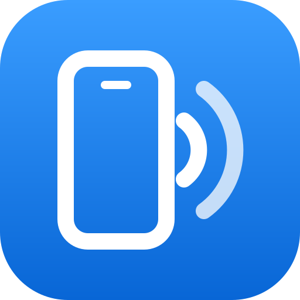
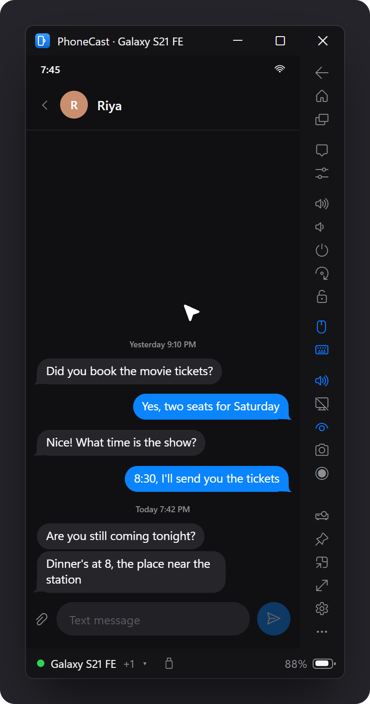

<p align="center">
  
</p>

<h1 align="center">PhoneCast</h1>

<p align="center">
  <b>Your Android phone on your Windows PC.</b><br>
  See its screen, control it with your mouse and keyboard, switch between phones, record, and keep
  using a phone even when its screen is broken.
</p>

<p align="center">
  <a href="LICENSE"></a>
  
  
  
</p>

<p align="center">
  <picture>
    <source media="(prefers-reduced-motion: reduce)" srcset="docs/demo.png">
    
  </picture>
</p>

PhoneCast started as a way to keep using a Samsung Galaxy S21 FE with a broken screen. It works
with any Android phone that has USB debugging on (also tested on a second, older phone), needs no
app on the phone, and connects by itself when you plug the cable in.

## Features

- **Mirror and control**: click to tap, drag to swipe, scroll, type, Ctrl+V to paste. Text copied
  on the phone lands in the PC's clipboard.
- **Several phones**: every connected phone is listed in the picker at the bottom left; switch with a
  click or **Ctrl+Alt+D**. The last phone you picked is preferred next time.
- **Wireless**: *Continue over Wi-Fi* moves the current phone off the cable, *Connect over Wi-Fi*
  and *Pair over Wi-Fi* add phones by address or pairing code.
- **Screen recording** to MP4 (Videos\PhoneCast). The phone's own video stream is saved without
  re-encoding, so it costs no quality and almost no CPU.
- **Screenshots** to Pictures\PhoneCast, or straight to the clipboard.
- **Phone sound** on the PC, phone **battery** in the status bar.
- **Protected screens**: Android blanks PIN pads and banking apps in every screen capture. PhoneCast
  draws an outline of their buttons so you can still use them, unlocks the lock screen with your PIN,
  and supports a USB HDMI capture card for a picture with nothing hidden.
- **Command search** (Ctrl+K) for every action, **compact window** (small, always on top), full
  screen, accent colours.
- **Minimal by design**: the phone's picture runs edge to edge; the buttons are plain icons in a thin
  column and the bottom bar is plain text, with no boxes or borders around any of it.
- Send files by dropping them on the window (an `.apk` gets installed); copy the phone's photos to the PC.

## Requirements

- Windows 10 or 11
- Python 3.12 or newer
- An Android phone with **USB debugging** on (Settings → About phone → tap *Build number* 7 times,
  then Settings → Developer options → USB debugging)

`adb` and the scrcpy server come bundled in `engine/scrcpy`.

## Install

```powershell
git clone https://github.com/sangwanaman/phonecast.git
cd phonecast
powershell -ExecutionPolicy Bypass -File .\install.ps1
```

The script creates a Python environment in `.venv`, installs the libraries from
`requirements.txt`, and adds **PhoneCast** shortcuts to the desktop and the Start menu.
To run it without shortcuts: `.venv\Scripts\pythonw -m app`.

Plug the phone in. The first time, the phone asks *Allow USB debugging?*: tap **Allow** (tick
*Always allow from this computer*). After that it connects by itself whenever the cable goes in.

## Controls

| Computer | Phone |
| --- | --- |
| Click / drag | Tap / swipe |
| Scroll | Scroll |
| Right-click | Back (also wakes the screen) |
| Middle-click | Home |
| Ctrl + drag | Pinch zoom / rotate |
| Typing | Types on the phone; Enter, Backspace, arrows, Tab, Esc (= Back) all work |
| Ctrl+V | Pastes the computer's clipboard into the phone |

| Shortcut | Does |
| --- | --- |
| Ctrl+K | Search every action |
| Ctrl+Alt+D | Switch phones |
| F11 | Full screen (mouse to the right edge shows the buttons) |
| Ctrl+Alt+I | Compact window: small, on top, no buttons |
| Ctrl+Alt+V | Start / stop screen recording |
| Ctrl+Alt+S | Screenshot to Pictures\PhoneCast |
| Ctrl+Alt+C | Screenshot to the clipboard |
| Ctrl+Alt+M / K | Mouse / keyboard control on or off |
| Ctrl+Alt+U | Unlock with PIN (or type it into a protected PIN box) |
| Ctrl+Alt+P | Type a PIN into the protected PIN box on screen |
| Ctrl+Alt+O | Outline of protected (black) screens on or off |
| Ctrl+Alt+H / B / R | Home / Back / Recent apps |
| F1 | Help |

## Why some screens are black

Android marks the lock-screen PIN pad, password boxes, banking and payment apps and some video apps
as *secure*, and blocks every screen-capture method from seeing them (scrcpy, Phone Link, this app).
Over USB they come out black. What PhoneCast does about it:

- **Outline view** (eye button, on by default): Android still describes protected screens to
  accessibility services, so PhoneCast draws their buttons, text and PIN boxes where the black
  picture is. Click them as usual.
- **Unlock** (lock button): wakes the phone, opens the PIN pad and types your PIN. It can remember
  the PIN, encrypted with your Windows login (DPAPI). On an unlocked phone it becomes **Type my PIN**
  for bank or "Verify it's you" prompts, and never types into ordinary text boxes.
- **HDMI capture mode**: a phone that supports video out sends everything over HDMI. With a cheap USB
  HDMI capture card the PC receives that signal, while the mouse and keyboard keep working over Wi-Fi.

Fingerprint prompts can't be answered from a computer: choose *Use PIN*.

## Broken-screen tip

Android forgets a computer's USB debugging permission after 7 days without a connection, and the
question it then asks can't be answered on a broken screen. In the phone's **Developer options**,
turn on **Disable adb authorization timeout** while you still can.

## Settings and files

- Settings (gear button): resolution, frame rate (up to 120 fps), quality, video format, sound,
  keep awake, phone screen off while mirroring, show taps, accent colour.
- Saved settings: `%APPDATA%\PhoneCast\settings.json`.
- If something breaks, run `install.ps1` again to repair the libraries and shortcuts.

## Project layout

| Path | What it is |
| --- | --- |
| `app/main.py` | Main window: connecting, phone switching, actions, recording, compact and full screen |
| `app/devices.py` | Which phone to connect to, and the phone list for the switcher |
| `app/session.py` | One mirroring session: starts the scrcpy server, decodes video, plays audio, sends input |
| `app/widgets.py` | The phone view (input forwarding, rounded picture) and small widgets |
| `app/dialogs.py` | Settings, PIN, Wi-Fi, HDMI capture, command search and help |
| `app/theme.py` | Colours, accent colours, icons and the stylesheet |
| `app/recorder.py` | Saves the phone's video stream to MP4 |
| `app/outline.py` | Reads protected screens' layout for the outline view |
| `app/protocol.py` | scrcpy control messages |
| `engine/scrcpy` | Bundled scrcpy 5.0.1 server and adb |
| `tests/` | Tests: the picture fills the window, the controls stay flat, phone picking |
| `docs/demo/` | Source of the demo animation above |

## Tests

```powershell
.venv\Scripts\python -m unittest discover -s tests
```

They draw the window offscreen (no phone or screen needed) and check what you'd see: the phone's
picture reaching every edge, no boxes or borders behind the buttons, and which phone gets picked.

## The demo animation

`docs/demo/` holds the demo as a [Stageshow](https://benji.org/stageshow) scene. To rebuild
`docs/demo.webp` and `docs/demo.png`: copy the folder to `examples/phonecast` in the Stageshow
skill, start its playground (`npm run dev`), then run
`node docs/demo/capture.mjs <stageshow folder> <frames folder> 20 17.5 8` and
`python docs/demo/encode.py <frames folder>`.

## Contributing

Issues and pull requests are welcome. Please run the tests before sending a change.

## License

[MIT](LICENSE) © 2026 Aman Sangwan. The bundled scrcpy server and adb keep their own Apache 2.0 license (`engine/scrcpy/LICENSE.txt`).

## Credits

Built on the open-source [scrcpy](https://github.com/Genymobile/scrcpy) 5.0.1 server by Genymobile
(Apache License 2.0, see `engine/scrcpy/LICENSE.txt`), with
[PySide6](https://doc.qt.io/qtforpython-6/), [PyAV](https://pyav.org/), NumPy and sounddevice.
